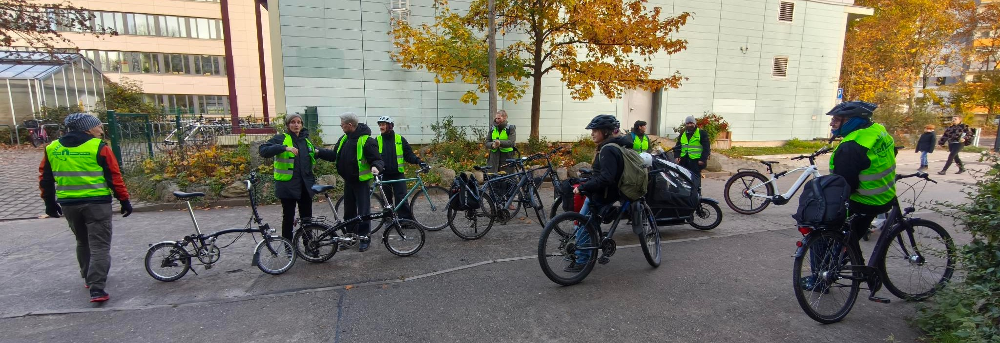

# Werner-Seelenbinder-Gedenkturnier

An unserer Schule waren 25 Vereine aus ganz Nord-Ost-Mitteldeutschland zu besuch, um beim Werner-Seelenbinder-Gedenkturnier die besten Kämpfer und Vereine zu ermitteln. In den verschiedenen Gewichtsklassen der unter 14-Jährigen (über 12 Jahre alt), der unter 17-Jährigen und unter 20-Jährigen, traten ingesamt 159 Kämpfer auf vier Matten an. Alle Turnierdetails sind in der [Ringerdatenbank](https://turniere.ringerdb.de/25863) einsehbar.

Von unserer Schule und den vielen Sportlern unseres Trainingsstützpunktes wurde das Turnier zusammen mit dem [VVN-VdA](https://vvn-vda.de/) veranstaltet und vom [TUS Hellersdorf](https://tus-hellersdorf.de/ringen-3/) ausgerichtet. Wir legten dabei großen Wert auf ein Gedenken, dass dem Wirken und überlieferten Anliegen Werner Seelenbindes einerseits und den Ansprüchen eines professionellen Sportereignisses andererseits gerecht wird.

<!-- ===== Galerie: Anfang ===== -->

<!-- ===== Galerie: Ende ===== -->
