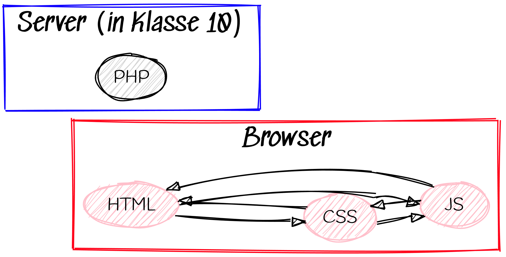
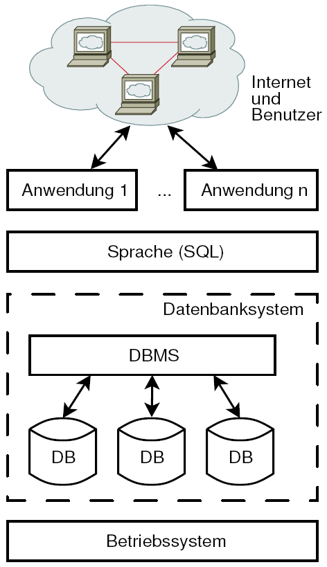

WPU 10 Informatik
===========

# Orga

> Wir sehen uns nur noch zwei Stunden pro Woche!

## Belehrungen

* [Regeln im NAWI-Fachraum](../../../Fachraumordnung_und_Experimentierregeln_SuS.pdf)
* [Regeln im Computerraum](../../../Regeln_Computerraum_2025-09-10.pdf)
* [Unterschriften](../../../Unterschriftenliste_Sicherheitsunterweisung_GCM_SuS.pdf)
* [Operatoren](../../../Operatoren_IQB_2025.md)
* [Kriterien für die mündliche Bewertung](../../../Kriterien_mündlich_SEK-I.md)

## Wichtige Tools

# Webentwicklung

> Vierte jetzt neue Technologie: PHP

[Einführung in PHP](php_einfuehrung.md)

# Datenbankensysteme

> Erläutere die Grafik und erkläre zu jedem der Bestandteile die Funktion.
>
> Think - Pair - Share

Wir arbeiten mit SQLite und folgendem Werkzeug: https://sqlitebrowser.org/

[Übungen zum Umgang mit Datenbanken](uebung_sqlite.md)

> ### Tägliche Übung
>
> - Zeige, wie man eine Datenbank erstellt
> - Zeige, wie man eine Tabelle erstellt
> - Zeige, wie man Daten in eine Tabelle einfügt
> - Zeige, was passiert, wenn man sich nicht an die Constraints hält
