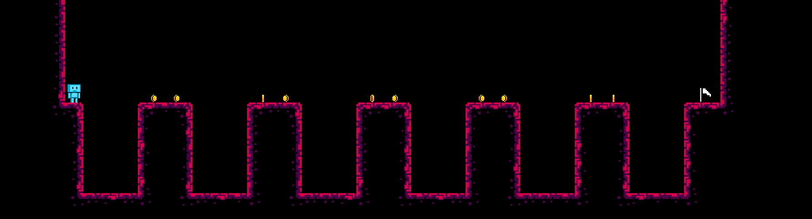

Wir beginnen mit den ersten Levels eines Roboterspiels: https://gcm.schule/jsrobot

## Level 1

Hier lernt man die Grundfunktionen kennen. Außerdem lernt man, die verschiedenen Tools zu nutzen.

**Achtung:** Wenn man etwas programmiert hat, muss man es auch erklären können. Alle Programme werden am Stundenende per Mail an den Lehrer gesendet. Wenn man früher fertig wird, darf man auch früher eine Mail schicken.

### Challenges

> Sammle keine Coins!

und

> Sammle exakt vier Coins!
