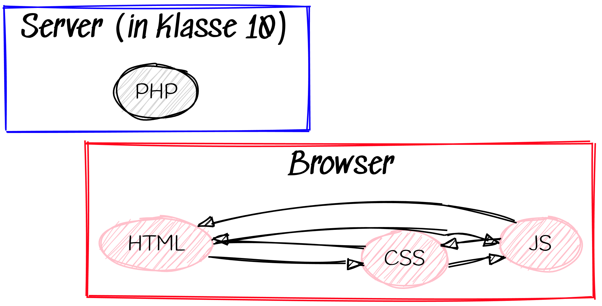

# Webentwicklung

> Dritte jetzt neue Technologie: JavaScript

## Aufgaben

1. Lies den Artikel über die Rollen der drei Technologien auf [selfhtml](https://wiki.selfhtml.org/wiki/HTML/Tutorials/Trennung_von_Inhalt,_Pr%C3%A4sentation_und_Verhalten)
1. Fertige eine Tabelle an, die nach folgendem Schema funktioniert:

|Abkürzung|richtiger Name|Nutzen und Zweck|
|---|---|---|
|HTML| | |
|CSS| | |
|JS| | |

# JavaScript

Das ist eine vollwertige Programmiersprache!

## Aufgaben (als Code along)

1. Erstelle mit KI eine freundliche Webseite, die auch schick aussieht.
1. Binde drei Bilder ein, die alle relativ klein dargestellt werden.
1. Ergänze JS-Code mit dem man die Größe verändert, sobald man mit dem Mauszeiger darüber schwebt.

### Code Snippets

#### HTML-Datei
~~~html
<!DOCTYPE html>
<html lang="de">
  <head>
    <meta charset="utf-8">
    <meta name="viewport" content="width=device-width, initial-scale=1.0">
    
    <title>Test</title>
    
  </head>
  <body>
    
  </body>
</html>

~~~

#### JS-Datei
~~~JavaScript
'use strict';

document.addEventListener('DOMContentLoaded', function ()
{
    alert("Ich heiße dich herzlich Willkommen!");
    document.getElementById('bild1').addEventListener('pointerover', zoom1_in);
    document.getElementById('bild1').addEventListener('pointerleave', zoom1_out);

});

function zoom1_in()
{
    var dasBild1 = document.getElementById('bild1');
    dasBild1.style.width = "400px";
}

function zoom1_out()
{
    var dasBild1 = document.getElementById('bild1');
    dasBild1.style.width = "200px";
}

~~~

## Ein schlechtes Beispiel

> Im Folgenden geht es darum, dass man das Konzept, das ihr bisher verfolgt habt, ins Absurde weiterdenkt. Gleichzeitig nähern wir uns der Idee eines Memoryspiels.

### Aufgaben

1. Lade das [Absurdes Beispiel ZIP-Archiv](AbsurdesBeispiel.zip) herunter und entpacke es.
1. Erkläre einem Mitschüler, weshalb das Beispiel schlecht programmiert ist.
1. Schreibe eine Mail an Deinen Lehrer, in welcher Du erklärst, weshalb das ein schlechtes Beispiel für Programmierung ist.

> Um eine allgemeine Funktion zu schreiben, die auf alle möglichen HTML-Elemente angewendet werden kann, verwendet man **Event-Delegation**.

~~~html
<!DOCTYPE html>
<html lang="de">
<head>
  <meta charset="UTF-8">
  <title>Event-Delegation mit benannter Funktion</title>
  
</head>
<body>

  

    <button>Knopf 1</button>
    <button>Knopf 2</button>
    <button>Knopf 3</button>
  

  

  

</body>
</html>
~~~

### Aufgaben

1. Überführe den JS-Code in eine eigene Datei und registriere sie im Kopf des HTML-Dokumentes
2. Probiere aus, was passiert, wenn Du beliebig viele Knöpfe ergänzt.
3. Dokumentiere Deine Erkenntnisse in einer Mail an Deinen Lehrer in der Du die beiden veränderten Dateien hochlädst.
4. Überführe das Konzept auf das Beispiel mit dem Pferde-Memory.
