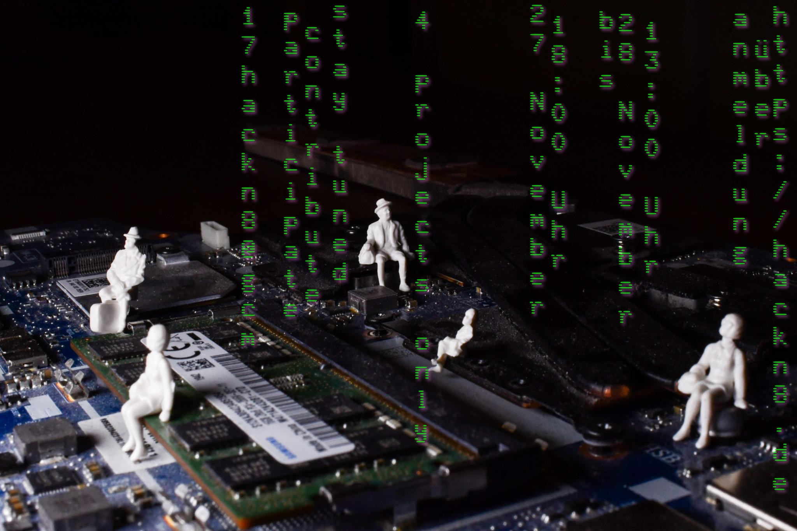

WPU 9 Informatik
===========

# Orga

> Wir sehen uns nur noch zwei Stunden pro Woche!

## Belehrungen

* [Regeln im NAWI-Fachraum](../../../Fachraumordnung_und_Experimentierregeln_SuS.pdf)
* [Regeln im Computerraum](../../../Regeln_Computerraum_2025-09-10.pdf)
* [Unterschriften](../../../Unterschriftenliste_Sicherheitsunterweisung_GCM_SuS.pdf)
* [Operatoren](../../../Operatoren_IQB_2025.md)
* [Kriterien für die mündliche Bewertung](../../../Kriterien_mündlich_SEK-I.md)

## Wichtige Tools

## Kennenlernen

1. Welche Computer nutzt du?
1. Welche Technologien nutzt du?
1. Welche Sprachen hast du kennengelernt?
1. Welche Projekte fandest du interessant?
1. Was möchtest du in Informatik lernen?
1. In welchen Kriterien für die mündl. Bewertung siehst du deine Stärken?

## Die großen Themen

- [Webentwicklung](Webentwicklung_mit_js.md)
- [Grundlagen der Programmierung](Grundlagen_der_Programmierung.md)
- [Spiel steuern mit JS](Spiel_steuern_mit_js.md)

## Noch vor der KA

## Was in der Klassenarbeit vorkommen wird

- Webtechnologien nennen und Erklären
- Event-Konzept erläutern
- EventListener an einem vorgegebenen Beispiel beschreiben
- Grundprinzipien der Programmierung erkennen und zuordnen
- Zeilenweise Beispielcode erklären (Kopf, Körper, Paramater, etc.)

## Übungen Klassenarbeit

- [Übung 1](KA_uebung.md)
- [Lösung 1](KA_uebung_lsg.md)
- [Übung 2](KA_uebung_2.md)
- [Lösung 2](KA_uebung_2_lsg.md)

Zur Unterhaltung und zur Prüfung eine Art Lernspiel: 

- [Trainingskonsole 07](Trainingskonsole_JS-07.html) nur Übungsaufgaben
- [Trainingskonsole 08](Trainingskonsole_JS-08.html) Übungsaufgaben und **Wissen/Lektionen** im Archiv
- [Trainingskonsole 09](Trainingskonsole_JS-09.html) Weitere Aufgabenformate, Duell-Modus, **Spiel**

---

> Have a lot of fun!
